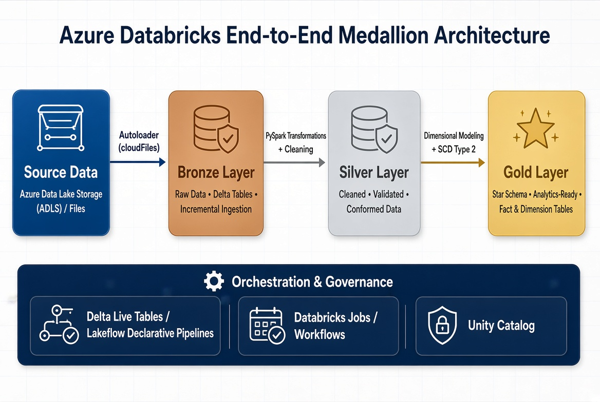
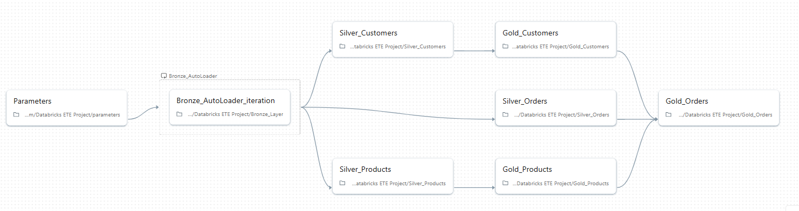
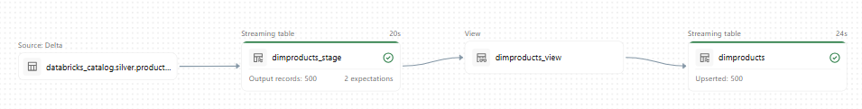

# Azure Databricks End-to-End Data Engineering Project

This project demonstrates an end-to-end data engineering solution built on Azure Databricks using the Medallion Architecture. The pipeline ingests raw data, standardizes and cleans it in the Silver layer, and builds curated analytical models in the Gold layer for reporting and dimensional analytics.

The solution covers customer, order, product, and region data, with incremental ingestion using Databricks Autoloader and curated transformations following best practices in modern lakehouse architecture.

---

## 1. Architecture

The project follows a Bronze → Silver → Gold workflow and is orchestrated using Databricks workflows and Delta Live Tables / Lakeflow Declarative Pipelines.

### High-Level Architecture



### Databricks Workflow Graph



### DLT Products Pipeline



---

## 2. Tech Stack

- Azure Databricks
- Apache Spark / PySpark
- Delta Lake
- Databricks Autoloader
- Delta Live Tables (DLT) / Lakeflow Declarative Pipelines
- Databricks Jobs & Workflows
- Python
- Parquet file datasets
- Serverless Compute (for DLT pipelines)

---

## 3. Project Structure

```text
azure-databricks-end-to-end-project/
├── architecture/
│   ├── high-level-architecture.jpg
│   ├── databricks-workflow-graph.png
│   └── dlt-products-pipeline.png
├── datasets/
│   └── sample parquet data files
├── notebooks/
│   ├── Bronze/
│   │   └── raw ingestion and Autoloader-based landing zone processing
│   ├── Silver/
│   │   └── transformations, cleaning, deduplication, and standardization
│   └── Gold/
│       └── dimensional models, curated tables, and SCD Type 2 logic
├── README.md
└── .gitignore
```

---

## 4. Key Features Implemented

- Medallion architecture implementation: Bronze, Silver, and Gold layers
- Incremental ingestion with Databricks Autoloader
- Raw-to-curated processing using PySpark transformations
- Data quality checks and cleaning in the Silver layer
- Dimensional modeling for analytical consumption
- Slowly Changing Dimension (SCD Type 2) implementation in the Gold layer
- Orchestration using Delta Live Tables and Databricks Jobs/Workflows
- Support for product, customer, order, and region datasets
- End-to-end pipeline design suitable for real-world analytics workloads

---

## 5. Challenges & Solutions

### Challenge 1: Azure Free Trial Compute Limitation

The Azure Free Trial included a limited 4-core compute quota, which constrained the ability to run heavier data engineering workloads and DLT pipelines effectively.

### Solution

To overcome this limitation, the project used Databricks Serverless compute for the DLT pipelines. This enabled:

- Reduced infrastructure management overhead
- Better compatibility with small trial environments
- Improved ability to run declarative pipelines without requiring large dedicated clusters
- A practical approach to building and demonstrating a lakehouse pipeline in a constrained environment

### Challenge 2: Incremental Data Ingestion at Scale

Managing incremental loads while avoiding duplicate data and maintaining historical correctness was an important design consideration.

### Solution

Autoloader was used for incremental ingestion into the Bronze layer, allowing efficient file-based ingestion while preserving scalability and minimizing reprocessing of already ingested files.

---

## 6. How to Run

### Prerequisites

- An Azure Databricks workspace
- Access to a Databricks cluster or serverless compute
- Databricks filesystem access for the dataset files
- Python and PySpark support in the cluster environment

### Steps

1. Create or attach to an Azure Databricks workspace.
2. Upload or mount the sample dataset files from the `datasets/` folder.
3. Open the notebooks in the following order:
   - `notebooks/Bronze/`
   - `notebooks/Silver/`
   - `notebooks/Gold/`
4. Run the Bronze notebook to load raw data using Autoloader.
5. Execute the Silver notebook for transformations and data cleaning.
6. Run the Gold notebook to create dimensional models and SCD Type 2 tables.
7. Optionally configure Databricks Jobs or DLT/Lakeflow pipelines to orchestrate the flow automatically.
8. Use serverless compute for DLT pipelines if working within an Azure Free Trial or limited-resource environment.

> Note: This repository is designed as a learning and portfolio project. Depending on your Databricks setup, some paths, storage configuration, and cluster settings may need to be adjusted.

---

## 7. Learnings

This project strengthened my understanding of several core data engineering concepts:

- Designing and implementing a lakehouse architecture using the Medallion pattern
- Building scalable incremental ingestion pipelines with Autoloader
- Writing robust PySpark transformations for real-world data-cleaning workflows
- Applying business logic in the Silver layer to ensure trusted data quality
- Modeling analytical datasets and dimensions for reporting use cases
- Implementing Slowly Changing Dimensions (SCD Type 2) to preserve historical data changes
- Orchestrating modern data pipelines with DLT and Databricks Workflows
- Solving environment constraints through cost-aware compute design using serverless processing

---

## 8. Author

### Project Author

- Name: [Your Name]
- Program / Degree: [Master's Student / Data Engineering / Computer Science]
- LinkedIn: [https://www.linkedin.com/in/your-profile]
- GitHub: [https://github.com/your-username]
- Email: [your.email@example.com]
- Portfolio: [https://your-portfolio-link.com]

This project was developed as part of a hands-on data engineering portfolio focused on Azure, Databricks, and modern lakehouse architecture.

---

## 9. Summary

This repository reflects a practical, end-to-end data engineering implementation that combines ingestion, transformation, data modeling, and orchestration into a single lakehouse workflow. It is intended to demonstrate technical capabilities in Azure Databricks, data engineering pipelines, and analytical data modeling in a professional portfolio context.

